# MODÉLISATION FONCTIONNELLE ET UML COMPLÈTE — TRADELINK SaaS B2B

**Date** : 24 novembre 2026  
**Branche** : `main`  
**Conformité** : Phase 2 (Sections 4.1 A à F) & Phase 16

---

## A. Diagramme de Cas d'Utilisation (Section 4.1.A)

Ce diagramme modélise l'ensemble des acteurs réels du système (`VISITEUR`, `CLIENT`, `FOURNISSEUR`, `TRANSPORTEUR`, `COMPTABLE`, `SUPPORT`, `ADMIN`, ainsi que le rôle organisationnel `COMPANY_ADMIN`/`COMPANY_OWNER`), leurs cas d'utilisation autorisés, leurs restrictions (notamment l'interdiction pour le `CLIENT` de créer ou d'administrer une Room Live, et l'accès en lecture seule du `COMPTABLE` sur les données commerciales sources) et les interactions avec les services externes (Google Gemini, Google Meet API v2, Stripe/Passerelles de paiement, ClamAV, HashiCorp Vault KMS).

```mermaid
flowchart LR
  subgraph Acteurs["Acteurs TRADELINK"]
    VIS["Visiteur Public (VISITEUR)"]
    CLI["Client / Acheteur B2B (CLIENT)"]
    FOU["Fournisseur / Exportateur (FOURNISSEUR)"]
    TRA["Transporteur / Logisticien (TRANSPORTEUR)"]
    COM["Comptable / Auditeur (COMPTABLE)"]
    SUP["Agent Support (SUPPORT)"]
    ORG["Admin d'Organisation (COMPANY_ADMIN)"]
    ADM["Superadministrateur (ADMIN + MFA)"]
  end

  subgraph UC_Public["Zone Publique & Onboarding"]
    UC1["Consulter le catalogue public"]
    UC2["S'inscrire et vérifier OTP Email/SMS"]
    UC3["S'authentifier (Argon2id + Session unique)"]
    UC4["Valider MFA TOTP RFC 6238"]
  end

  subgraph UC_Org_KYC["Organisation & Conformité KYC"]
    UC5["Créer/Gérer l'entreprise B2B & Inviter des membres"]
    UC6["Soumettre les pièces KYC chiffrées KMS"]
    UC7["Auditer, Valider, Rejeter ou Demander Complément KYC"]
  end

  subgraph UC_Commerce["Catalogue, Stocks, Devis, Commandes & Paiements"]
    UC8["Créer/Publier des produits & Gérer les stocks"]
    UC9["Demander un devis (RFQ), Négocier & Passer commande"]
    UC10["Émettre factures/avoirs & Payer en séquestre"]
    UC11["Arbitrer un litige commercial"]
  end

  subgraph UC_Logistique["Logistique Multimodale & POD"]
    UC12["Gérer les missions, GPS, Chaîne du froid & e-CMR"]
    UC13["Soumettre la preuve de livraison (POD) & Signaler un incident"]
  end

  subgraph UC_Compta["Comptabilité & Finance"]
    UC14["Tenir les journaux, Grand Livre, Balance, Rapprochement & FEC"]
    UC15["Contre-passer une écriture & Calculer intérêts ACT/365"]
  end

  subgraph UC_Docs["Système Documentaire, Import/Export & OCR/IDP"]
    UC16["Importer fichiers (Tableurs, Docs, XML/YAML, SQL/DBF/CDX/BAK, Archives)"]
    UC17["Analyser par OCR/IDP & Valider humainement"]
    UC18["Exporter les données multi-formats dans son périmètre"]
    UC19["Approuver à 4 yeux (Dual Admin) une migration Sandbox"]
  end

  subgraph UC_Collab["Messagerie, Room Live, IA & Traduction"]
    UC20["Échanger via Messagerie B2B & Recevoir Notifications"]
    UC21["Créer, Planifier & Modérer une Room Live / Google Meet"]
    UC22["Rejoindre uniquement une Room Live autorisée (Sans droit de création)"]
    UC23["Utiliser l'Assistant IA Gemini & Traduire (FR/EN/AR/ES)"]
  end

  subgraph Externes["Services Externes"]
    EXT_MEET["Google Meet API v2 & OAuth 2.0"]
    EXT_GEMINI["Google Gemini 1.5 Pro/Flash API"]
    EXT_PAY["Stripe / Konnect / Flouci / CMI"]
    EXT_SEC["ClamAV clamd & HashiCorp Vault KMS"]
  end

  VIS --> UC1
  VIS --> UC2
  VIS --> UC3

  CLI --> UC3
  CLI --> UC6
  CLI --> UC9
  CLI --> UC10
  CLI --> UC18
  CLI --> UC20
  CLI --> UC22
  CLI --> UC23

  FOU --> UC3
  FOU --> UC6
  FOU --> UC8
  FOU --> UC9
  FOU --> UC10
  FOU --> UC16
  FOU --> UC17
  FOU --> UC18
  FOU --> UC20
  FOU --> UC21
  FOU --> UC23

  TRA --> UC3
  TRA --> UC6
  TRA --> UC12
  TRA --> UC13
  TRA --> UC20
  TRA --> UC21
  TRA --> UC23

  COM --> UC3
  COM --> UC14
  COM --> UC15
  COM --> UC17
  COM --> UC18
  COM --> UC21
  COM --> UC23

  SUP --> UC3
  SUP --> UC20
  SUP --> UC21
  SUP --> UC23

  ORG --> UC5
  ORG --> UC6

  ADM --> UC3
  ADM --> UC4
  ADM --> UC5
  ADM --> UC7
  ADM --> UC11
  ADM --> UC16
  ADM --> UC18
  ADM --> UC19
  ADM --> UC21
  ADM --> UC23

  UC6 --> EXT_SEC
  UC16 --> EXT_SEC
  UC10 --> EXT_PAY
  UC21 --> EXT_MEET
  UC23 --> EXT_GEMINI
```

---

## B. Diagramme de Classes du Domaine (Section 4.1.B)

Ce diagramme représente les 30 classes métier principales correspondant aux modèles Prisma (`prisma/schema.prisma`) et aux moteurs TypeScript (`src/types/index.ts`, `src/services/*.ts`).

```mermaid
classDiagram
  class User {
    +UUID id
    +String email
    +String passwordHash
    +UserRoleCode role
    +Boolean mfaEnabled
    +String totpSecretEncrypted
    +KYCStatus kycStatus
    +Boolean isSuspended
    +DateTime createdAt
  }

  class UserProfile {
    +UUID userId
    +String firstName
    +String lastName
    +String phone
    +Locale preferredLocale
    +String avatarUrl
  }

  class Role {
    +UUID id
    +UserRoleCode code
    +String labelFr
    +Boolean mfaMandatory
    +Boolean canCreateRoomLive
  }

  class Permission {
    +String id
    +String resource
    +String action
    +String scope
    +String sensitivityLevel
  }

  class UserSession {
    +UUID id
    +UUID userId
    +String jti
    +String refreshTokenHash
    +Boolean mfaVerified
    +String ipAddress
    +DateTime expiresAt
  }

  class Company {
    +UUID id
    +String companyCode
    +String legalName
    +String actorType
    +String registrationNumber
    +String taxId
    +CompanyStatus status
    +UUID ownerUserId
  }

  class CompanyMember {
    +UUID memberId
    +UUID companyId
    +UUID userId
    +CompanyInternalRole internalRole
    +String[] permissions
  }

  class KYCDossier {
    +UUID id
    +UUID userId
    +String companyName
    +KYCStatus status
    +Int daysRemaining
    +DateTime deadlineAt
  }

  class KYCDocument {
    +UUID id
    +UUID dossierId
    +String docType
    +String sha256
    +String encryptionKeyId
    +String virusScanStatus
  }

  class ProductCategory {
    +UUID id
    +String code
    +UUID parentId
    +Boolean isActive
  }

  class Product {
    +UUID id
    +String sku
    +UUID supplierId
    +UUID categoryId
    +Decimal priceAmount
    +String currency
    +Int stockAvailable
    +Int stockReserved
    +Int minOrderQuantity
    +ProductStatus status
  }

  class Catalog {
    +UUID supplierId
    +Product[] publishedProducts
    +DateTime updatedAt
  }

  class Quote {
    +UUID id
    +String quoteNumber
    +UUID clientId
    +UUID supplierId
    +String status
    +Decimal totalAmount
    +DateTime validUntil
  }

  class Order {
    +UUID id
    +String orderNumber
    +UUID clientId
    +UUID supplierId
    +String status
    +String paymentStatus
    +Decimal subtotalAmount
    +Decimal taxAmount
    +Decimal totalAmount
  }

  class OrderLine {
    +UUID id
    +UUID orderId
    +UUID productId
    +String sku
    +Int quantity
    +Decimal unitPrice
    +Decimal totalLine
  }

  class Invoice {
    +UUID id
    +String invoiceNumber
    +UUID orderId
    +UUID clientId
    +UUID supplierId
    +Decimal totalHt
    +Decimal taxAmount
    +Decimal totalTtc
    +String status
  }

  class Payment {
    +UUID id
    +String paymentReference
    +UUID orderId
    +UUID invoiceId
    +String provider
    +Decimal amount
    +String status
    +String escrowStatus
  }

  class Shipment {
    +UUID id
    +String trackingNumber
    +UUID orderId
    +UUID carrierId
    +String status
    +String transportMode
  }

  class CommercialDocument {
    +UUID id
    +String documentNumber
    +String documentType
    +String jurisdiction
    +String digitalSealSha256
    +Boolean isArchived
  }

  class DocumentFolder {
    +UUID id
    +UUID companyId
    +String folderType
    +Int documentsCount
  }

  class AccountingTransaction {
    +UUID id
    +String reference
    +Decimal amount
    +String currency
    +DateTime executedAt
  }

  class AccountingEntry {
    +UUID id
    +String entryNumber
    +JournalCode journalCode
    +String fiscalPeriod
    +Decimal totalDebit
    +Decimal totalCredit
    +Boolean isBalanced
    +Boolean isImmutable
    +UUID reversesEntryId
  }

  class Conversation {
    +UUID id
    +String title
    +String type
    +String relatedEntityId
  }

  class ChatMessage {
    +UUID id
    +UUID conversationId
    +UUID senderId
    +String text
    +DateTime createdAt
  }

  class Notification {
    +UUID id
    +UUID userId
    +String category
    +String priority
    +Boolean isRead
  }

  class RoomLive {
    +UUID id
    +String roomCode
    +UUID createdById
    +String status
    +MeetingProvider meetingProvider
    +String googleMeetSpaceName
    +String googleMeetUri
  }

  class RoomParticipant {
    +String id
    +UUID roomId
    +UUID userId
    +UserRoleCode role
    +Boolean isHost
    +String status
  }

  class TranslationRecord {
    +String id
    +String entityType
    +SupportedLocale sourceLang
    +SupportedLocale targetLang
    +String originalText
    +String translatedText
    +Boolean isCertified
  }

  class AuditLog {
    +String id
    +String actorName
    +UserRoleCode actorRole
    +String action
    +String targetType
    +String targetId
    +String previousHash
    +String currentHash
  }

  User "1" --> "1" UserProfile : possède
  User "1" --> "*" UserSession : ouvre
  User "*" --> "1" Role : détient
  Role "1" --> "*" Permission : accorde
  Company "1" --> "*" CompanyMember : regroupe
  User "1" --> "*" CompanyMember : appartient
  User "1" --> "0..1" KYCDossier : soumet
  KYCDossier "1" --> "*" KYCDocument : contient
  Company "1" --> "*" DocumentFolder : organise
  DocumentFolder "1" --> "*" CommercialDocument : archive
  ProductCategory "1" --> "*" Product : classe
  Catalog "1" --> "*" Product : expose
  User "1" --> "*" Product : fournit (FOURNISSEUR)
  User "1" --> "*" Quote : demande/reçoit
  Quote "1" --> "0..1" Order : convertit en
  Order "1" --> "1..*" OrderLine : comporte
  Order "1" --> "0..*" Invoice : génère
  Order "1" --> "0..*" Payment : règle
  Order "1" --> "0..*" Shipment : expédie
  Payment "1" --> "1" AccountingTransaction : déclenche
  AccountingTransaction "1" --> "1..*" AccountingEntry : comptabilise
  Conversation "1" --> "*" ChatMessage : contient
  User "1" --> "*" Notification : reçoit
  RoomLive "1" --> "1..*" RoomParticipant : accueille
  User "1" --> "*" AuditLog : génère
```

---

## C. Diagrammes de Séquence des 21 Processus Essentiels (Section 4.1.C)

### C.1. Inscription, Authentification et Vérification MFA (Processus 1, 2, 3)

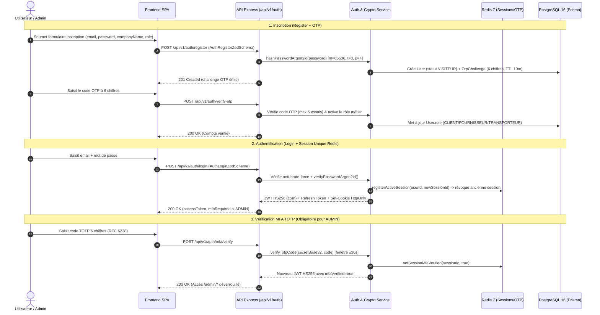

### C.2. Création d'Organisation, Invitation et Attribution de Rôle (Processus 4, 5, 6)

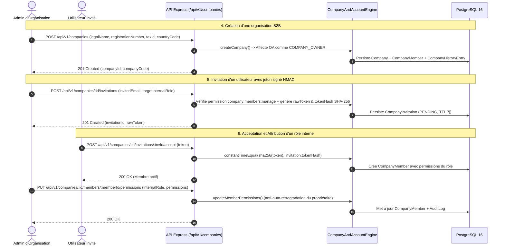

### C.3. Produit, Catalogue, Devis (RFQ), Commande, Paiement et Facturation (Processus 7 à 12)

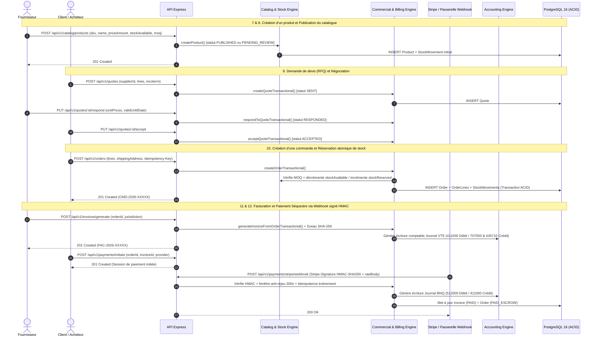

### C.4. Import Documentaire, Extraction OCR/IDP et Export de Données (Processus 13, 14, 15)

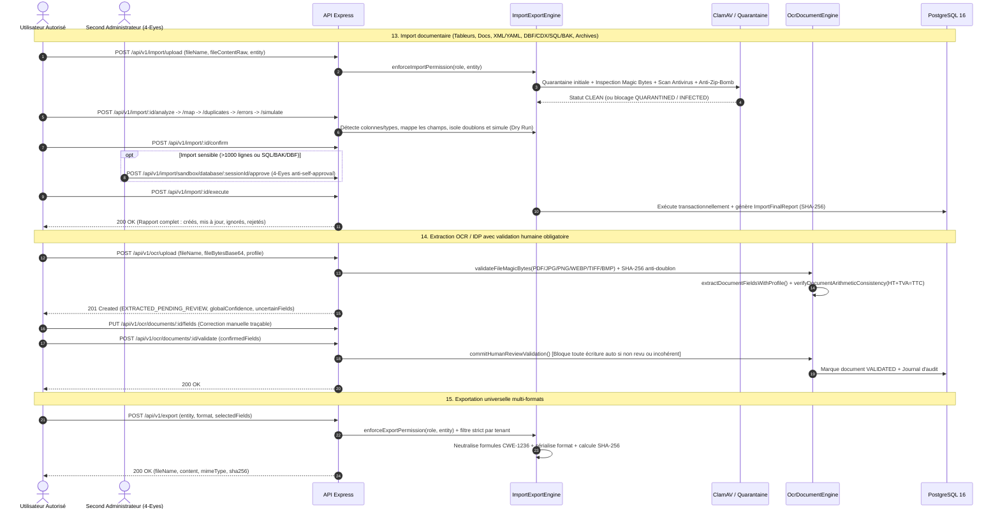

### C.5. Création Room Live, Rejoindre Room Live et Google Meet API v2 (Processus 16, 17, 18)

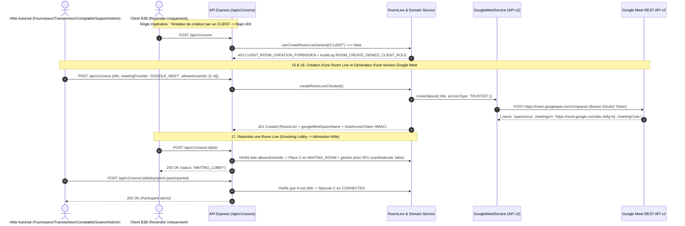

### C.6. Traduction de Contenu, Assistant IA Gemini et Intervention Administrateur (Processus 19, 20, 21)

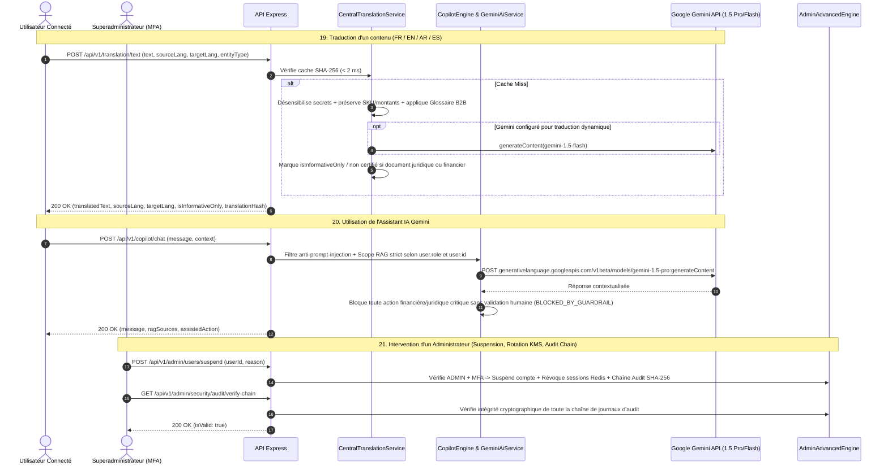

---

## D. Diagrammes d'Activité des 10 Workflows Métier (Section 4.1.D)

### D.1. Workflow KYC et Validation d'Entreprise (Workflows 1 & 2)

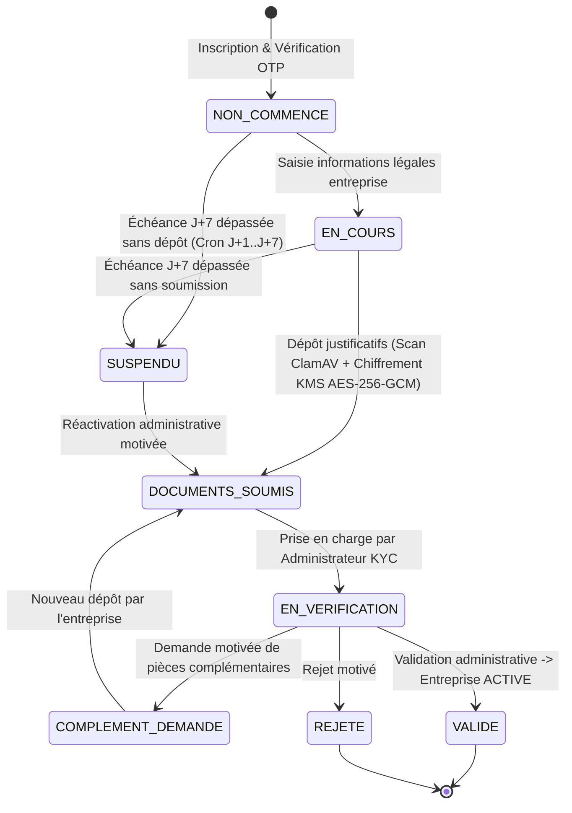

### D.2. Workflow Gestion des Commandes, Paiements, Factures et Litiges (Workflows 3, 4, 7, 8)

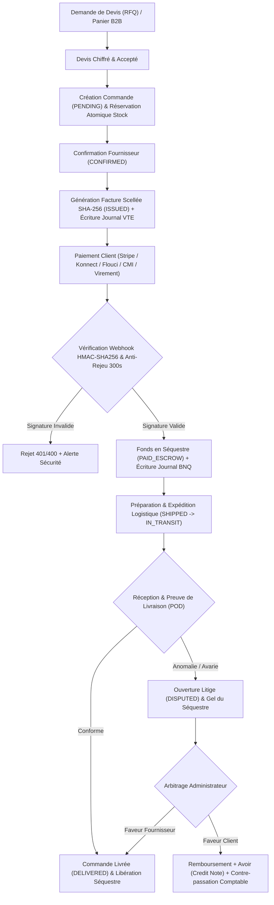

### D.3. Workflow Traitement Documentaire, Import/Export et OCR/IDP (Workflows 5 & 6)

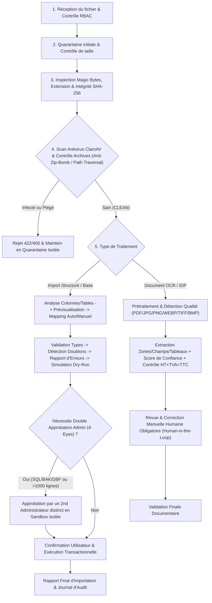

### D.4. Workflow Gestion d'une Réunion Room Live / Google Meet et Notifications (Workflows 9 & 10)

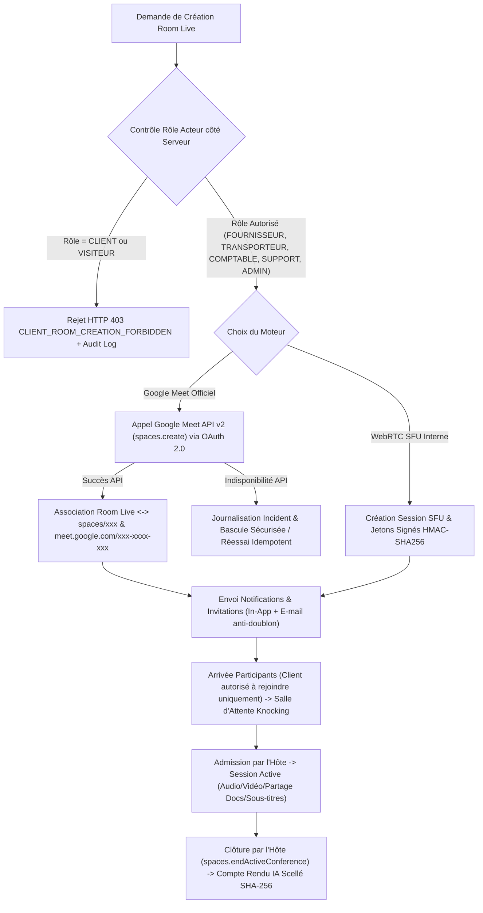

---

## E. Diagramme de Composants (Section 4.1.E)

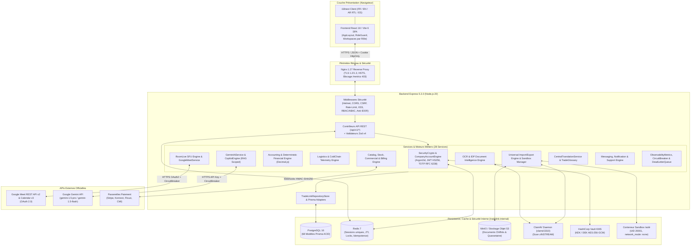

---

## F. Diagramme de Déploiement Multi-Environnements (Section 4.1.F)

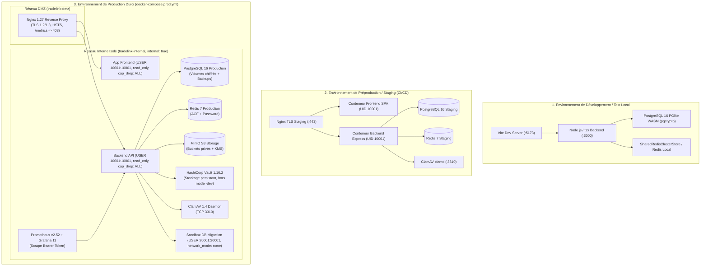
